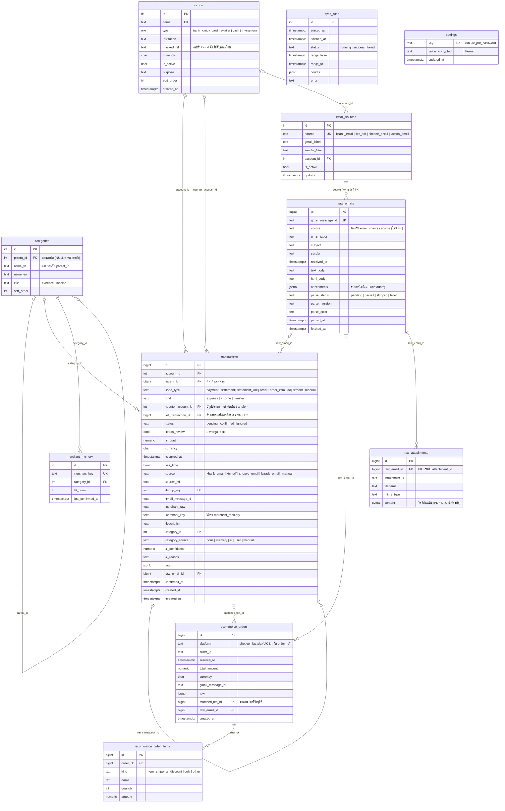

# ER diagram: schema `ledger`

สร้างจาก DB จริง (migration 0005, 2026-10-05) ถ้าเพิ่ม migration ให้อัปเดตไฟล์นี้ด้วย ส่วนตาราง `alembic_version` ไม่ได้แสดง

ภาพ PNG: [er-diagram.png](er-diagram.png) (render จาก Mermaid ข้างล่าง ใช้ดูใน editor ที่ไม่รองรับ Mermaid ถ้าแก้ diagram ให้ render ใหม่ด้วย `npx @mermaid-js/mermaid-cli -i <ไฟล์ .mmd> -o docs/er-diagram.png -w 2400 -b white`)

## กลุ่มของตาราง

| กลุ่ม | ตาราง | หน้าที่ |
|---|---|---|
| ข้อมูลหลัก (master) | `accounts`, `categories` | บัญชีของผู้ใช้ และหมวดหมู่ 2 ระดับ |
| ledger | `transactions` | ทุกรายการ เก็บเป็นต้นไม้ในตารางเดียว |
| การเรียนรู้ | `merchant_memory` | ร้าน/ผู้รับ → หมวด ที่ผู้ใช้เคยยืนยัน |
| ข้อมูลดิบ | `email_sources`, `raw_emails`, `raw_attachments`, `sync_runs` | label ต่อแหล่ง อีเมล/ไฟล์ต้นฉบับ และประวัติ sync |
| รอจับคู่ | `ecommerce_orders`, `ecommerce_order_items` | order ของ Shopee/Lazada ก่อนผูกกับรายการจ่าย (ยังไม่ได้ใช้ รอ T1.3) |
| ความลับ | `settings` | ค่าที่เข้ารหัส เช่น รหัส PDF ของ KTC |

## View

- **`v_reportable_expenses`**: `transactions` ที่ `status = 'confirmed'`, `kind = 'expense'` และไม่มีลูก (leaf) เป็นแหล่งเดียวของรายงานรายจ่าย จึงไม่นับรายการแม่และ transfer

## กติกาที่ schema บังคับ

- `transactions.kind = 'transfer'` ต้องมี `counter_account_id`
- `transactions.dedup_key` ไม่ซ้ำ ทำให้ sync ซ้ำได้โดยไม่เกิดรายการซ้ำ
- ลบรายการแม่จะลบลูกทั้งต้นไม้ (`parent_id ON DELETE CASCADE`) ลบอีเมลดิบจะลบไฟล์แนบ ส่วนรายการที่อ้างอีเมลนั้นจะเหลือ `raw_email_id = NULL`
- `email_sources` จะเปิด (`is_active`) ได้ก็ต่อเมื่อมี `gmail_label`

## จะเปลี่ยนใน Phase 6 (ยังไม่มีใน DB)

- **T6.2** `merchant_memory`: เพิ่ม `action` (`category | transfer | ask`) และ `counter_account_id` → `accounts`
- **T6.4** `transactions`: `node_type = opening_balance` และ `kind = opening` สำหรับยอดเริ่มต้น และ view `v_postings` แปลงแต่ละรายการเป็น 2 ขา (เดบิต/เครดิต) ใช้คำนวณยอดคงเหลือ
- **T6.5** ตารางเก็บรูปใบเสร็จ และ `node_type = receipt_item` สำหรับรายการย่อยจากใบเสร็จ
