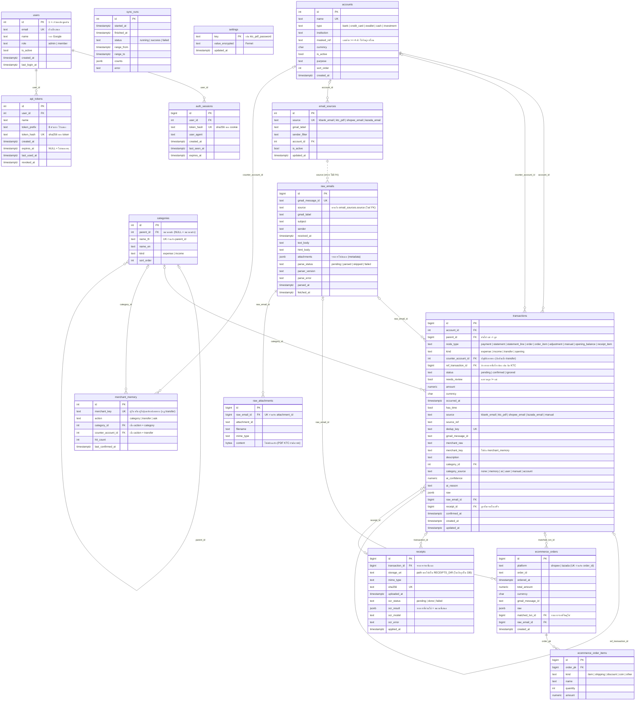

# ER diagram: schema `ledger`

สร้างจาก DB จริง (migration 0011, 2026-10-06) ถ้าเพิ่ม migration ให้อัปเดตไฟล์นี้ด้วย ส่วนตาราง `alembic_version` ไม่ได้แสดง

ภาพ PNG: [er-diagram.png](er-diagram.png) (render จาก Mermaid ข้างล่าง ใช้ดูใน editor ที่ไม่รองรับ Mermaid ถ้าแก้ diagram ให้ render ใหม่ด้วย `npx @mermaid-js/mermaid-cli -i <ไฟล์ .mmd> -o docs/er-diagram.png -w 2400 -b white`)

## กลุ่มของตาราง

| กลุ่ม | ตาราง | หน้าที่ |
|---|---|---|
| ข้อมูลหลัก (master) | `accounts`, `categories` | บัญชีของผู้ใช้ และหมวดหมู่ 2 ระดับ |
| ledger | `transactions` | ทุกรายการ เก็บเป็นต้นไม้ในตารางเดียว |
| การเรียนรู้ | `merchant_memory` | กฎต่อผู้รับที่ผู้ใช้เคยยืนยัน: หมวด / โอนเข้าบัญชีตัวเอง / ไม่ต้องจำ |
| ข้อมูลดิบ | `email_sources`, `raw_emails`, `raw_attachments`, `sync_runs` | label ต่อแหล่ง อีเมล/ไฟล์ต้นฉบับ และประวัติ sync |
| รอจับคู่ | `ecommerce_orders`, `ecommerce_order_items` | order ของ Shopee/Lazada ก่อนผูกกับรายการจ่าย (ยังไม่ได้ใช้ รอ T1.3) |
| ใบเสร็จ | `receipts` | รูปใบเสร็จและผลที่อ่านได้ ลูกที่แยกออกมาชี้กลับด้วย `transactions.receipt_id` |
| ความลับ | `settings` | ค่าที่เข้ารหัส เช่น รหัส PDF ของ KTC |
| ผู้ใช้ | `users`, `auth_sessions`, `api_tokens` | ผู้ใช้ (admin/member), session จาก Google sign-in และ API token เก็บแค่ sha256 ของความลับ ข้อมูลยังไม่แยกต่อผู้ใช้ (P7.2) |

## View

- **`v_reportable_expenses`**: `transactions` ที่ `status = 'confirmed'`, `kind = 'expense'` และไม่มีลูก (leaf) เป็นแหล่งเดียวของรายงานรายจ่าย จึงไม่นับรายการแม่และ transfer

- **`v_account_postings`**: ความเคลื่อนไหวของเงินต่อบัญชี (บวก = เข้า, ลบ = ออก) ใช้คำนวณยอดคงเหลือ ขาบัญชีมาจากรายการ root (expense/transfer ออก, income/opening เข้า) และทุก transfer มีอีกขาเข้าบัญชีปลายทาง การโอนระหว่างบัญชีตัวเองจึงรวมกันได้ 0

## กติกาที่ schema บังคับ

- `transactions.kind = 'transfer'` ต้องมี `counter_account_id`
- `transactions.dedup_key` ไม่ซ้ำ ทำให้ sync ซ้ำได้โดยไม่เกิดรายการซ้ำ
- ลบรายการแม่จะลบลูกทั้งต้นไม้ (`parent_id ON DELETE CASCADE`) ลบอีเมลดิบจะลบไฟล์แนบ ส่วนรายการที่อ้างอีเมลนั้นจะเหลือ `raw_email_id = NULL`
- `email_sources` จะเปิด (`is_active`) ได้ก็ต่อเมื่อมี `gmail_label`

## จะเปลี่ยนใน Phase 6 (ยังไม่มีใน DB)

